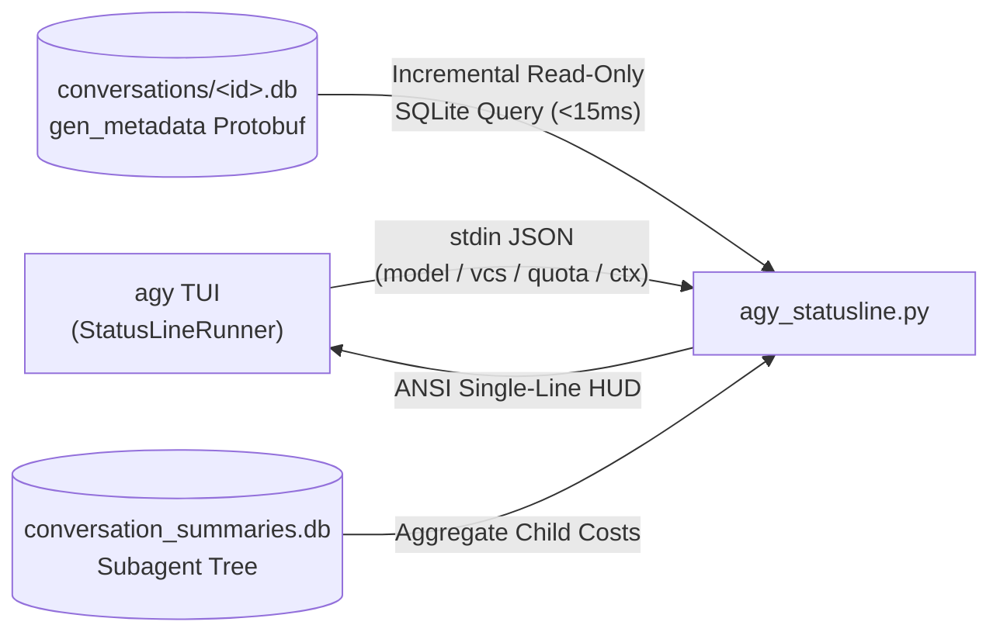

# agy-statusline

Unified HUD statusline for Google Antigravity CLI (`agy`).  
Visual context progress bar, session-level token and cache telemetry, equivalent API cost, live generation speed, and quota countdowns in a single clean line.

[English](README.md) | [简体中文](README_CN.md)

[](https://www.python.org/)
[-2ea44f)](#)
[](#)
[](./LICENSE)


---

## Features

`agy-statusline` replaces the default top-right statusline with an integrated, single-line HUD rendered directly in the terminal bottom bar (`stack_with_default: false`). Built with standard Python 3 libraries, it introduces zero third-party dependencies and adds less than 15ms overhead per refresh.

- **Native Status Integration**: Retains model name, reasoning effort (e.g., `Gemini 4 Argon (High)`), cycle mode (`accept-edits`, `plan`, `auto`, `best-of-n`), Vim mode (`-- INSERT --`), Git branch with dirty indicator (`⎇ main*`), and active subagent/task counts.
- **High-Precision Context Progress Bar (`CTX`)**: 1/8-cell Unicode fractional block elements (`▏▎▍▌▋▊▉█`) with 4-tier dynamic color thresholds (`<50%` green, `50-75%` yellow, `75-90%` orange, `>=90%` red with `⚠`).
- **Session Token Usage, Cache Hit Ratio & Cost (`Σ / 💰`)**: Reads `gen_metadata` protobuf frames from `~/.gemini/antigravity-cli/conversations/<id>.db` incrementally and aggregates child subagents from `conversation_summaries.db`. Displays session total tokens (`Σ`), cache hit ratio (`Cache XX%`), and equivalent API USD cost (`💰 $X.XX`).
- **Live Generation Speed (`⚡ tok/s`)**: Computes latest turn output throughput from TTFT and streaming duration (`⚡ X.X tok/s`) with an active execution spinner (`⟳`).
- **5h & Weekly Quota Countdown (`detailed` preset)**: Automatically selects quota buckets matching the active model family (`gemini-5h` / `gemini-weekly` or `3p-5h` / `3p-weekly` for Claude / GPT-OSS) and displays remaining percentage and reset countdowns (e.g., `Quota 5h:77%(29m) Wk:89%(6d14h)`).

---

## Presets & Switching

Four runtime modes are supported. You can switch presets instantly inside `agy` using the native `/statusline` command (0ms latency, no LLM invocation required). Both English and Chinese commands are supported out of the box:

| Command (English) | Command (Chinese) | Mode | Example Output |
| :--- | :--- | :--- | :--- |
| `/statusline off` | `/statusline off` | **Disabled** | *(Hides statusline)* |
| `/statusline minimal` | `/statusline 简洁` | **Minimal** | `Gemini 4 Argon (H) · plan │ CTX [██████▌░] 81% │ Σ 640k · 💰 $0.42 │ ⚡ 45.0 tok/s` |
| `/statusline standard` | `/statusline 标准` | **Standard** (Default) | `Gemini 4 Argon (High) · auto · ⎇ main* │ CTX [██▍░░░░░░░] 23.4% (245k/1.05M) │ Σ 12.4M (Cache 96%) · 💰 $7.48 │ ⚡ 42.8 tok/s` |
| `/statusline detailed` | `/statusline 详细` | **Detailed** (+Quota) | Appends `│ Quota 5h:77%(29m) Wk:89%(6d14h)` to standard mode |

---

## Installation

### Method 1 (Recommended): Native `/plugin` Command

Inside `agy`, run:

```text
/plugin install https://github.com/s1nc3ju1y/agy-statusline
```

Or from your shell:

```bash
agy plugin install https://github.com/s1nc3ju1y/agy-statusline
```

The plugin includes `hooks.json`, which automatically configures `settings.json` and installs the bilingual preset wrappers into `~/.local/bin` on startup.

### Method 2: Shell One-Liner

```bash
curl -fsSL https://raw.githubusercontent.com/s1nc3ju1y/agy-statusline/main/install.sh | bash
```

### Method 3: Clone & Install

```bash
git clone https://github.com/s1nc3ju1y/agy-statusline.git
cd agy-statusline
python3 agy_statusline.py --install
```

> [!NOTE]
> Ensure `~/.local/bin` is in your `$PATH` (the default installation directory for `agy`). This allows `/statusline minimal | standard | detailed` (and `/statusline 简洁 | 标准 | 详细`) to execute directly.

### CLI Options

```bash
# Preview all three presets in terminal
python3 agy_statusline.py --demo

# Install and enable detailed preset by default
python3 agy_statusline.py --install --preset detailed

# Cycle presets (standard -> detailed -> minimal)
python3 agy_statusline.py --cycle

# Uninstall and restore default statusline
python3 agy_statusline.py --uninstall
```

---

## Architecture



- **Incremental SQLite Cache**: Reads only rows where `idx > max_idx` and caches state under `/tmp/agy-statusline-<uid>/`.
- **Fault-Tolerant Execution**: Any parse failure or empty input gracefully falls back to a clean placeholder and always exits with code `0`, preventing `agy` from auto-disabling the statusline.

---

## Testing

```bash
python3 -m unittest discover -s tests -v
```

---

## License

Released under the [MIT License](./LICENSE). Built for Google Antigravity CLI (`agy`).
