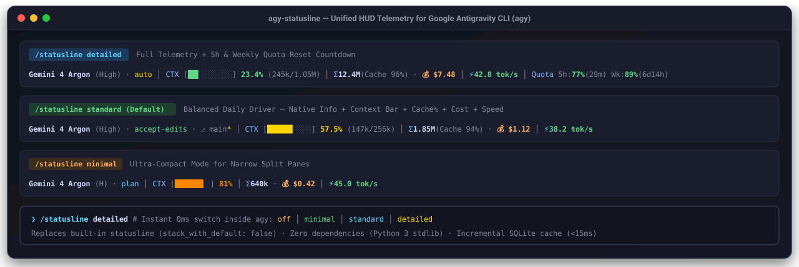
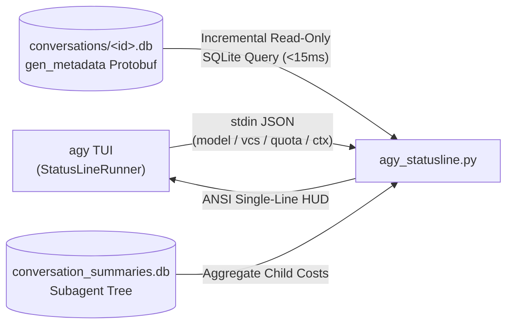

<div align="center">

# 🚀 agy-statusline

**Unified HUD Statusline for Google Antigravity CLI (`agy`)**  
*Visual Context Bar · Session Token & Cache Telemetry · Equivalent API Cost · Live `tok/s` Speed · 5h & Weekly Quota*

[](https://www.python.org/)
[-2ea44f)](#)
[](#)
[](./LICENSE)



[**中文说明**](#-核心特性-features) · [**Quick Start**](#-一键安装-quick-install) · [**Presets & `/statusline` Switching**](#-四档模式切换-bilingual-preset-switching) · [**Architecture**](#-工作原理-architecture)

</div>

---

## ✨ 核心特性 (Features)

`agy-statusline` 是专为 **Google Antigravity CLI (`agy`)** 打造的一体化 HUD 状态栏插件，**零第三方依赖**（纯 Python 3 标准库），默认完全替代右上角原生状态栏（`stack_with_default: false`），将分散的状态信息与底层 SQLite 遥测浓缩为清爽的单行 HUD：

1. **🎯 融入原生状态栏信息 (Native Status Integration)**
   - 完整保留模型与推理强度徽标（如 `Gemini 4 Argon (High)`）、运行模式（`accept-edits` / `plan` / `auto` / `best-of-n`）、Vim 模式（`-- INSERT --`）、Git 分支与脏工作区标记（`⎇ main*`）以及活跃子 Agent / 后台任务计数。
2. **📊 HUD 可视化上下文进度条 (`CTX`)**
   - 1/8 字符精度 Unicode 进度条（`▏▎▍▌▋▊▉█`），支持四级颜色动态告警（`<50%` 绿、`50–75%` 黄、`75–90%` 橙、`≥90%` 红 + `⚠` 标记）。
3. **💰 会话级 Token 总量、Cache 命中率与等效 API 成本 (`Σ / 💰`)**
   - 直接增量解析 `~/.gemini/antigravity-cli/conversations/<id>.db` 中的 `gen_metadata` Protobuf 帧（并自动汇总 `conversation_summaries.db` 关联的子 Agent 开销），展示会话 **总 Token (`Σ`)**、**缓存命中率 (`Cache XX%`)** 与 **等效 API 美元花费 (`💰 $X.XX`)**。
4. **⚡ 实时 Token 生成速度 (`⚡ tok/s`)**
   - 精确提取每轮 `time_to_first_token` 与 `streaming_duration`，实时展示最新一轮 Token 吞吐速度（`⚡ X.X tok/s`）与运行态指示（`⟳`）。
5. **🔋 5h Quota & Weekly Quota 实时监控 (`detailed` / `详细` 档位)**
   - 自动按当前模型家族匹配 `gemini-5h` / `gemini-weekly` 或 `3p-5h` / `3p-weekly`（Claude / GPT-OSS）配额池，直观展示剩余百分比与重置倒计时（如 `Quota 5h:77%(29m) Wk:89%(6d14h)`）。

---

## 🎛️ 四档模式切换 (Bilingual Preset Switching)

安装后无需记忆复杂参数，直接在 `agy` 输入框中使用内置的 **`/statusline`** 命令即可 **0ms 瞬时切换**（支持中英文双语，不触发 AI 对话）：

| 命令 (中文) | Command (English) | 档位说明 (Description) | 显示内容示例 (Example Output) |
| :--- | :--- | :--- | :--- |
| `/statusline off` | `/statusline off` | **关闭状态栏** (Disable) | *(隐藏状态栏)* |
| `/statusline 简洁` | `/statusline minimal` | **简洁模式** (Minimal) | `Gemini 4 Argon (H) · plan │ CTX [██████▌░] 81% │ Σ 640k · 💰 $0.42 │ ⚡ 45.0 tok/s` |
| `/statusline 标准` | `/statusline standard` | **标准模式** (Default) | `Gemini 4 Argon (High) · auto · ⎇ main* │ CTX [██▍░░░░░░░] 23.4% (245k/1.05M) │ Σ 12.4M (Cache 96%) · 💰 $7.48 │ ⚡ 42.8 tok/s` |
| `/statusline 详细` | `/statusline detailed` | **详细模式** (+Quota) | 在 `标准` 基础上追加 `│ Quota 5h:77%(29m) Wk:89%(6d14h)` |

---

## 📦 一键安装 (Quick Install)

### 方式一：单行脚本安装 (One-Liner)

```bash
curl -fsSL https://raw.githubusercontent.com/s1nc3ju1y/agy-statusline/main/install.sh | bash
```

### 方式二：克隆仓库安装 (Git Clone)

```bash
git clone https://github.com/s1nc3ju1y/agy-statusline.git
cd agy-statusline
python3 agy_statusline.py --install
```

> [!TIP]
> 确保 `~/.local/bin` 在你的 `$PATH` 中（`agy` 默认安装路径即为 `~/.local/bin`），这样 `/statusline 简洁|标准|详细` 与 `/statusline minimal|standard|detailed` 即可直接在 `agy` 内生效。

### 常用命令行参数 (CLI Options)

```bash
# 预览三种预设渲染效果 (Preview all 3 presets in terminal)
python3 agy_statusline.py --demo

# 安装并默认启用详细模式 (Install with detailed preset by default)
python3 agy_statusline.py --install --preset detailed

# 在 standard -> detailed -> minimal 之间循环切换 (Cycle presets)
python3 agy_statusline.py --cycle

# 卸载并恢复默认设置 (Uninstall and clean up wrappers)
python3 agy_statusline.py --uninstall
```

---

## 🏗️ 工作原理 (Architecture)



- **增量缓存 (`<15ms`)**：每次刷新仅查询 SQLite `gen_metadata` 表中 `idx > max_idx` 的新增轮次，缓存在 `/tmp/agy-statusline-<uid>/`，对大长会话依然保持毫秒级响应。
- **永不报错退出**：任何异常或空输入均优雅降级，保证返回码为 `0`，避免触发 `agy` 的自动禁用机制。

---

## 🧪 运行测试 (Testing)

```bash
python3 -m unittest discover -s tests -v
```

---

## 📄 License

Released under the [MIT License](./LICENSE). Built with ❤️ and **Gemini 4 Argon** inside **Antigravity CLI**.
