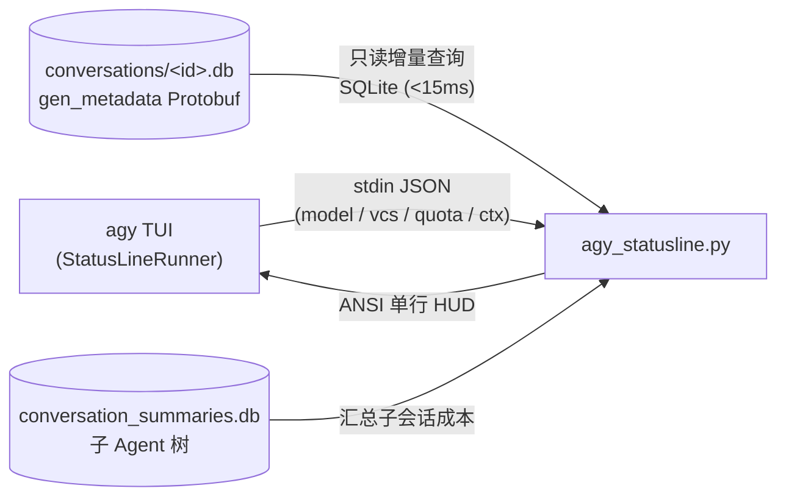

# agy-statusline

Google Antigravity CLI (`agy`) 一体化 HUD 状态栏插件。  
将可视化上下文进度条、会话级 Token 与 Cache 遥测、等效 API 成本、实时生成速度以及配额倒计时浓缩为单行底栏。

[English](README.md) | [简体中文](README_CN.md)

[](https://www.python.org/)
[-2ea44f)](#)
[](#)
[](./LICENSE)


---

## 核心特性

`agy-statusline` 专为 Google Antigravity CLI (`agy`) 打造，用于完全替代原生右上角状态栏（`stack_with_default: false`）。仅依赖 Python 3 标准库，无任何第三方包，单次渲染开销低于 15 毫秒。

- **融入原生状态信息**：完整保留当前模型与推理强度徽标（如 `Gemini 4 Argon (High)`）、运行模式（`accept-edits`、`plan`、`auto`、`best-of-n`）、Vim 模式（`-- INSERT --`）、Git 分支与工作区状态（`⎇ main*`）以及后台任务与子 Agent 计数。
- **高精度上下文进度条 (`CTX`)**：采用 1/8 字符精度的 Unicode 分数方块字符（`▏▎▍▌▋▊▉█`），支持四级动态颜色告警（`<50%` 绿、`50-75%` 黄、`75-90%` 橙、`>=90%` 红并带 `⚠` 标记）。
- **会话级 Token 用量、Cache 命中率与等效成本 (`Σ / 💰`)**：增量解析 `~/.gemini/antigravity-cli/conversations/<id>.db` 的 `gen_metadata` Protobuf 记录，并结合 `conversation_summaries.db` 汇总子 Agent 开销。显示会话总 Token (`Σ`)、缓存命中率 (`Cache XX%`) 与等效 API 美元花费 (`💰 $X.XX`)。
- **实时生成速度 (`⚡ tok/s`)**：根据首字延迟（TTFT）与流式耗时计算最新一轮 Token 生成吞吐量（`⚡ X.X tok/s`），并在生成过程中展示动态指示符（`⟳`）。
- **5h 与 Weekly 配额倒计时 (`detailed` 档位)**：根据当前活跃模型自动匹配对应的配额池（Gemini 对应 `gemini-5h` / `gemini-weekly`，Claude / GPT-OSS 对应 `3p-5h` / `3p-weekly`），显示剩余比例与重置倒计时（例如 `Quota 5h:77%(29m) Wk:89%(6d14h)`）。

---

## 预设档位与切换

插件支持四种运行档位。在 `agy` 中直接使用内置的 `/statusline` 命令即可瞬时完成切换（0 毫秒延迟，无需经过 AI 模型处理）。命令天然支持中英双语：

| 英文命令 | 中文命令 | 档位说明 | 输出示例 |
| :--- | :--- | :--- | :--- |
| `/statusline off` | `/statusline off` | **关闭状态栏** | *(隐藏状态栏)* |
| `/statusline minimal` | `/statusline 简洁` | **简洁模式** | `Gemini 4 Argon (H) · plan │ CTX [██████▌░] 81% │ Σ 640k · 💰 $0.42 │ ⚡ 45.0 tok/s` |
| `/statusline standard` | `/statusline 标准` | **标准模式** (默认) | `Gemini 4 Argon (High) · auto · ⎇ main* │ CTX [██▍░░░░░░░] 23.4% (245k/1.05M) │ Σ 12.4M (Cache 96%) · 💰 $7.48 │ ⚡ 42.8 tok/s` |
| `/statusline detailed` | `/statusline 详细` | **详细模式** (+配额) | 在标准模式基础上追加 `│ Quota 5h:77%(29m) Wk:89%(6d14h)` |

---

## 安装方式

### 方式一（推荐）：使用 `agy` 内置 `/plugin` 命令

在 `agy` 输入框中直接输入：

```text
/plugin install https://github.com/s1nc3ju1y/agy-statusline
```

或在终端运行：

```bash
agy plugin install https://github.com/s1nc3ju1y/agy-statusline
```

插件内置的 `hooks.json` 会在会话启动时自动完成 `settings.json` 配置，并在 `~/.local/bin` 中注册中英文双语档位脚本。

### 方式二：单行 Shell 脚本安装

```bash
curl -fsSL https://raw.githubusercontent.com/s1nc3ju1y/agy-statusline/main/install.sh | bash
```

### 方式三：克隆仓库手动安装

```bash
git clone https://github.com/s1nc3ju1y/agy-statusline.git
cd agy-statusline
python3 agy_statusline.py --install
```

> [!NOTE]
> 请确保 `~/.local/bin` 已加入你的系统的 `$PATH`（`agy` 默认安装位置即在此处）。这使得 `/statusline 简洁 | 标准 | 详细` 与 `/statusline minimal | standard | detailed` 能够被系统直接定位执行。

### 常用命令行选项

```bash
# 在终端中预览三种预设效果
python3 agy_statusline.py --demo

# 安装并默认使用详细模式
python3 agy_statusline.py --install --preset detailed

# 依次循环切换预设 (standard -> detailed -> minimal)
python3 agy_statusline.py --cycle

# 卸载并恢复原生默认状态栏
python3 agy_statusline.py --uninstall
```

---

## 架构原理



- **增量 SQLite 缓存**：每次仅读取 `idx > max_idx` 的增量行，并在 `/tmp/agy-statusline-<uid>/` 中缓存聚合数据。
- **故障隔离与容错**：任何解析异常或空输入均回退至整洁的安全占位字符，并始终保证退出码为 `0`，避免触发 `agy` 的状态栏自动停用保护。

---

## 测试运行

```bash
python3 -m unittest discover -s tests -v
```

---

## 开源协议

基于 [MIT 协议](./LICENSE) 发布。专为 Google Antigravity CLI (`agy`) 设计构建。
